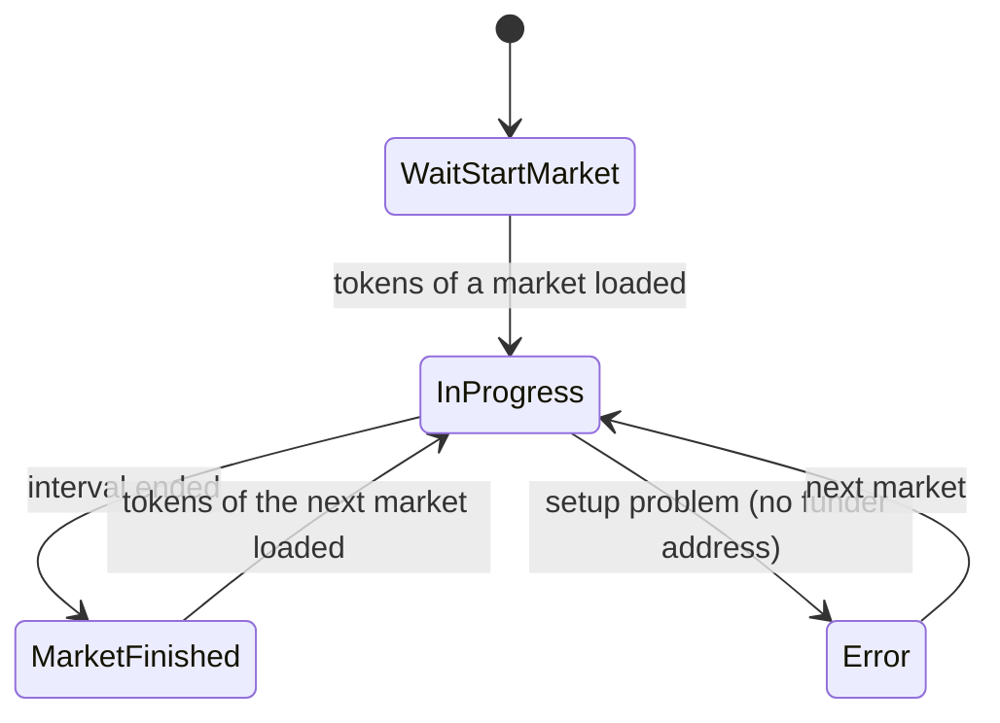

# Architecture

How the client is put together: the components, how a market is followed from start to end, how an order is built, and the decisions behind it. References point to classes and methods rather than line numbers.

## Overview

```mermaid
graph TD
    subgraph Monitoring
      UI[UIDisplay] -- Start / Stop --> MC[MarketController]
      MC --> UI
      MC --> API[ApiManager]
      MC --> MS[MarketState]
      MC --> ACC[TradeAccumulator]
    end

    API --> Gamma[(Gamma API<br/>markets, tokens)]
    API --> Book[(CLOB /book)]
    API --> Trades[(Data API /trades)]
    API --> Binance[(Binance<br/>BTC price)]

    subgraph Trading
      GUI[TradeTestOnGui] --> TM[PolymarketTradeManager]
      TM --> BOOT[PolymarketL2CredsBootstrap]
      TM --> REST[PolymarketClobRestClient]
      TM --> DATA[PolymarketDataApiClient]
    end

    TM -- reads every frame --> MS
    BOOT --> Secrets[(Secrets/polymarket.local.json)]
    BOOT --> Auth[(CLOB /time, /auth/*)]
    REST --> Order[(CLOB /fee-rate, /order)]
    DATA --> Positions[(Data API /positions)]

    subgraph Pure C#, tested in OrderMath
      CORE[OrderAmountCalculator · OrderBookCheck · OrderSendOutcome<br/>MarketInterval · TradeVolumeCalculator · TradeAccumulator]
    end
```

The two parts meet in one place: `PolymarketTradeManager` reads `MarketState` (through `MarketController.GetMarketStateSafe`) and treats a change of token ids as the start of a new market.

## Components

| Component | Responsibility |
|---|---|
| `MarketController` | Finds the market, sets it up, runs the polling loops (order books, trades, BTC price), updates the UI. |
| `ApiManager` | HTTP requests to Gamma, CLOB `/book`, Data API `/trades` and Binance. Every request has a 10 s timeout. |
| `MarketState` | Data of the current market: interval, prices, order books with the time they arrived, token ids, conditionId. |
| `UIDisplay` | TextMesh Pro fields and the Start / Stop buttons. |
| `PolymarketL2CredsBootstrap` | Reads the private key from a local file, signs the L1 `ClobAuth` message, gets API credentials and keeps them in memory. |
| `PolymarketTradeManager` | Buy and Sell: checks, pricing, amounts, signing, sending; trading state, dry-run mode, double-click guard. |
| `PolymarketClobRestClient` | `GET /fee-rate` and `POST /order` with L2 (HMAC) headers; `POST /order` has a 15 s timeout. |
| `PolymarketDataApiClient` | `GET /positions`: how many shares of an outcome the wallet holds. |
| `PolymarketClobAuthSigner`, `PolymarketL2Auth` | EIP-712 signature for L1 auth (hashed by hand) and HMAC-SHA256 for L2 requests. |
| `LocalSecrets` | Loads `Secrets/polymarket.local.json`, which is outside `Assets` and ignored by git. |

Pure C# classes, no `UnityEngine`, linked into the `OrderMath` .NET project and tested there:

| Class | Responsibility |
|---|---|
| `OrderAmountCalculator` | makerAmount / takerAmount in `decimal`, rounding a position down to 0.01 share. |
| `OrderBookCheck` | Best ask or bid, only from a book of the right token that is at most 5 s old. |
| `OrderSendOutcome` | Classifies the answer to `POST /order` as accepted, rejected or unknown. |
| `MarketInterval` | Start and end of the 15-minute interval, the slug timestamp and slug candidates. |
| `TradeVolumeCalculator` | USD volume (price × size) and count of trades inside the interval. |
| `TradeAccumulator` | Trades of the current market collected across polls without duplicates; decides when to load the next page. |

## Following a market

`MarketController.FindAndSetupMarket` runs while monitoring is on:

1. **Search.** Build the slug of the current interval and look it up in Gamma; if that fails, search the list of active events; if nothing is found, fall back to a test market.
2. **Reset and set up.** `SetupMarketWithHistoricalPrice` first calls `MarketState.ResetForNewMarket`, so tokens, books, prices and volume of the previous market cannot leak into the new one. Then it loads the token ids and conditionId.
3. **No tokens yet.** A new market can be listed before its CLOB tokens exist. In that case the controller searches again after 3 s instead of waiting for the end of the interval.
4. **Polling.** Order books and the BTC price every `updateInterval` (1 s by default), trades every 5 s. A book response is ignored if the token changed while the request was in flight.
5. **End.** When the interval is over, the result is logged and the search starts again for the next market.

**Trade volume.** One Data API page holds only the latest 200 trades. Each poll loads pages until it reaches trades it already has (by time) or trades before the interval start, at most 25 pages. `TradeAccumulator` keeps the trades without duplicates, a fill is identified by transaction, token, side, wallet, size, price and time, and starts over when the conditionId changes.

## Placing an order

**Before the coroutine starts** (`Buy`, `Sell`): the trade manager must be `InProgress`, no other order may be in flight, and a Buy amount must be a finite number above 0 and at most 100 USD.

**Buy** (`BuyCoroutine`):
1. Token of the active outcome → fee rate → API credentials from memory → maker address → server time.
2. Price: `OrderBookCheck` on the book of this token. If the book is missing, belongs to another token or is older than 5 s, the order is not sent and the reason is logged.
3. Amounts: `OrderAmountCalculator` in `decimal` (1 USDC = 1 share = 1,000,000 units).
4. EIP-712 typed data → signature with Nethereum → payload.
5. Dry run (`realTradingEnabled` off, the default): log a summary and stop. Otherwise `POST /order`.

**Sell** (`SellCoroutine`), up to `sellMaxAttempts`: before every attempt read the position from `/positions` and sell that size rounded down to 0.01 share. No position on the first attempt means the Data API has not caught up yet; no position on a later attempt means an earlier attempt already sold it, so it stops. Below 5 shares nothing is sold.

**Result of `POST /order`** (`OrderSendOutcome`):

| Answer | Result | What the user sees |
|---|---|---|
| no answer (timeout, network) or 5xx | unknown | "check your position before trying again" |
| 4xx or `success=false` | rejected | "nothing was bought, you can try again" |
| `success=true` | accepted | completion event |

**Order in flight.** A flag set before the coroutine starts and cleared in a `finally` block of `RunOrder` (normal end, early exit or exception) and in `OnDisable`, because Unity does not run `finally` for stopped coroutines.

## Trading state



A failed order does not change the state: `OrderFailed` logs the reason and trading stays available. Only a problem that a retry cannot fix moves to `Error`. When a click is ignored, the log says why (`NotReadyReason`).

## Decisions and trade-offs

- **Pure classes outside Unity.** The money and data logic is tested with `dotnet test` without the editor. The files are linked into the .NET project, not copied, so there is one source. There are no tests in the Unity Test Runner, because that needs assembly definitions for all scripts, including the Nethereum and TextMesh Pro references.
- **Measure before changing the money math.** The old `float` formulas were first moved into `OrderAmountCalculator` unchanged and proven bit-for-bit equal on about 7 million inputs, then switched to `decimal`. A reference test keeps the old formulas to show the difference (for example a $16.03 buy: 16030001 → 16030000 micro-USDC).
- **An order error is not a trading stop.** The user can try again in the same market; `Error` is kept for problems a retry cannot fix.
- **Price only from verified data.** A slightly older but checked price is refused rather than risking an order priced from the previous market.
- **No periodic reset timer.** The old timer restarted the search every 900 s from the Start click. It duplicated the normal market switch, could interrupt a market in the middle, and after the state reset it would have blanked prices mid-market. Retrying the token load covers the case it used to recover from.
- **Dry run by default.** The app sends real orders, so the safe setting is the default one.

## Limits

- The Data API can return trades several minutes late, so the volume of the last minutes may be missing (see Known issues in the README).
- `MarketController` still combines market search, polling and UI updates.
- If the market search coroutine throws, monitoring stops until Start is pressed again.
- The price to beat comes from Binance, while Polymarket resolves these markets with Chainlink.
- The key file is read from the project folder, which works in the Editor only.
