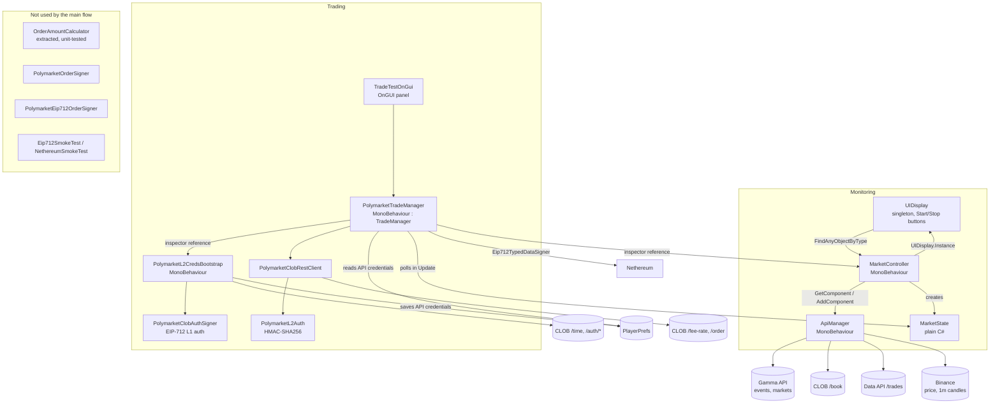

# Architecture

This document describes how the client is put together, the decisions behind the recent cleanup, and questions an interviewer is likely to ask about the code. Line numbers refer to the `refactor` branch at the time of writing.

Everything below was checked by reading the code. After the cleanup the project compiles in Unity 6000.3.0f1 (per the author). Nothing has been run in Unity as part of this work; runtime behavior is marked **not verified in Unity**. The only automated tests are in the .NET project `OrderMath/`.

## System diagram

The two parts are connected in one place: `PolymarketTradeManager` reads `MarketState` through `MarketController.GetMarketStateSafe()` (`MarketController.cs:33`) every frame (`PolymarketTradeManager.cs:61-99`).

## Main classes

All files are in `Assets/Scripts/` unless stated otherwise.

| Class | File (lines) | Purpose |
|---|---|---|
| `MarketController` | `MarketController.cs` (665) | Starts/stops monitoring, finds the market, runs the polling loops (order books, trades, price, 15-minute reset), updates the UI, logs the result. |
| `ApiManager` | `ApiManager.cs` (496) | Coroutine-based HTTP calls: market search by slug (`:314-360`), fallback search in the event list (`:362`), order book, trades, Binance price and candles. |
| `MarketState` | `MarketState.cs` (306) | Plain C# state of the current market: interval, prices, best bid/ask, token ids, order books. |
| `UIDisplay` | `UIDisplay.cs` (187) | Singleton with TextMesh Pro fields and Start/Stop buttons. |
| `PolymarketL2CredsBootstrap` | `PolymarketL2CredsBootstrap.cs` (459) | Holds the private key field; on `Start` (`:49`) signs L1 auth and derives or creates API credentials, saves them to PlayerPrefs. |
| `PolymarketClobAuthSigner` | `PolymarketClobAuthSigner.cs` | Hand-written EIP-712 digest and signature for the `ClobAuth` message (`:26`, `:68`). |
| `PolymarketL2Auth` | `PolymarketL2Auth.cs` | HMAC-SHA256 signature for L2 requests, URL-safe base64 (`:8-32`). |
| `PolymarketTradeManager` | `PolymarketTradeManager.cs` (519) | `Buy`/`Sell`, order JSON, EIP-712 order signing via Nethereum, state machine and events of the `TradeManager` interface. |
| `PolymarketClobRestClient` | `PolymarketClobRestClient.cs` | `GET /fee-rate` and `POST /order` with L2 headers. |
| `TradeManager` (interface) | `TradeManager.cs` | Contract for trading UI: events, `Buy`/`Sell`, `MarketManagerStates`, `MarketDataTik`. |
| `TradeTestOnGui` | `TradeTestOnGui.cs` | IMGUI test panel: amount field, Buy UP, Buy DOWN, Sell. |
| `OrderAmountCalculator` | `OrderAmountCalculator.cs` and `OrderMath/OrderMath/` | makerAmount/takerAmount for BUY and SELL without Unity or Nethereum. Extracted and unit-tested, not yet wired into the trading code. |

## Decisions and why

### Existing design (found in the code)

- **Market interval is computed from UTC time, not from API dates.** `MarketState.UpdateMarketInfo` ignores `startDate`/`endDate` and rounds the current time down to 15 minutes (`MarketState.cs:97-103`, `:131-141`). The code comment says the API dates are incorrect. Trade-off: if the market is loaded right at a 15-minute boundary, the interval can belong to the next market.
- **`MarketState` is a plain C# class**, not a MonoBehaviour. This is the one piece of monitoring state that could be unit-tested.
- **Stale coroutines are guarded by a market counter.** `FindAndSetupMarket` captures `thisMarketId` and checks `thisMarketId == currentMarketId` before acting (`MarketController.cs:152`, `:198-216`).
- **Two ways to sign EIP-712.** L1 auth is hashed by hand in `PolymarketClobAuthSigner`; orders are signed with Nethereum's `Eip712TypedDataSigner` from a hand-built JSON (`PolymarketTradeManager.cs:243`, `:347`). Order signing and payload format were not changed, because the author confirmed orders work.

### Cleanup decisions

- **Secrets removed from logs, error logs kept short.** API credentials, the L1 signature and raw `/auth/*` responses are no longer logged. On HTTP errors only `responseCode` and `req.error` are logged, not the response body (`PolymarketL2CredsBootstrap.cs:219`, `:266`). Trade-off: less detail when debugging auth problems.
- **Bug fix for trades volume after a market switch.** `currentConditionId` was set only when empty, so after a switch the trades loop kept using the old market. Now it is set from the freshly loaded `marketState.conditionId` right after the new token ids (`MarketController.cs:282`). It is assigned rather than reset to `null`: an old order book request can still finish after the switch, and its callback only writes `currentConditionId` when the field is empty (`:339-340`). Status: fixed, pending verification in Unity.
- **`OrderAmountCalculator` is a plain C# class outside Unity.** It targets `netstandard2.1` with C# 9 (same as Unity 6) and lives in a separate .NET solution `OrderMath/`, so it can be tested with `dotnet test` without the Unity editor. An identical copy is in `Assets/Scripts/`. Trade-off: two copies of one file must be kept in sync. The Unity copy compiles in Unity (per the author); its results under Unity are not verified.
- **`float` kept on purpose.** The current BUY code multiplies a `float` USD amount by `long` 1,000,000 in single precision, then uses `Math.Round` (banker's rounding) (`PolymarketTradeManager.cs:226-227`). The calculator copies this exactly, so it gives bit-for-bit the same amounts. Changing to `decimal` would change real order amounts in some cases: for example $16.03 gives `16030001` micro-USDC with the float path and `16030000` with exact decimal math. The result is returned as `long` micro-units.
- **Invalid input returns `false` instead of throwing.** For valid input the results are identical to the trading code. For `NaN`/`Infinity` the trading code throws `OverflowException` inside a coroutine; the calculator returns `false`.
- **Calculator not wired into `PolymarketTradeManager` yet.** When it was extracted, Unity was not available to compile MonoBehaviour changes. Wiring it in changes the live order path, so it should be done together with a test of real Buy/Sell in Unity.
- **No `.asmdef`.** Adding assembly definitions changes how Nethereum, TextMesh Pro and UI are referenced; a mistake breaks compilation of the whole project. This must be done in the editor.
- **No renames of MonoBehaviours or serialized fields, no code deleted.** Scenes reference scripts and fields by name; renaming without the editor can silently break inspector references. Unused classes stay until they can be checked against the scene.
- **Only comment changes in the AI-leftover cleanup.** Chat leftovers in comments were removed or rewritten; code lines are identical apart from removed trailing comments.

## Interview questions

**1. Why is `MarketController` 665 lines, and how would you split it?**
It does market search, setup, four polling loops, a 15-minute reset timer, volume calculation, result logging and UI updates (`MarketController.cs`). A split: a market finder (search + setup), a data poller (order books, trades, price), and a presenter that updates `UIDisplay`. `MarketController` would only coordinate them and raise events.

**2. A coroutine does `yield return StartCoroutine(...)` and then waits in a `while` loop with a timeout. What does the loop do?**
Almost nothing. `yield return StartCoroutine(x)` already waits until `x` finishes, so the flag is usually set before the loop (`MarketController.cs:178-183`, `:266-271`, `:439-444`). A real timeout belongs on the request itself (`UnityWebRequest.timeout`), which is not set anywhere.

**3. Where is the private key stored and who can read it?**
In the serialized field `privateKeyHex` of `PolymarketL2CredsBootstrap` (`PolymarketL2CredsBootstrap.cs:27`), so Unity saves it in the scene file. Any class can get it through the public `GetPrivateKeyHex()` (`:444`); `PolymarketTradeManager` creates an `EthECKey` from it for every order (`PolymarketTradeManager.cs:242`, `:346`). API credentials are in PlayerPrefs (`:425`). Better: load the key from outside the repository and keep it inside one signer object.

**4. What happens if the user clicks Buy twice quickly?**
Two orders. `Buy` only checks the state and starts a new coroutine each time (`PolymarketTradeManager.cs:137-146`). The fix is an "order in flight" flag that is set before `StartCoroutine` and cleared on every exit path.

**5. Why is money a `float`? What would you change?**
The USD amount comes from `float.TryParse` (`TradeTestOnGui.cs:23`, `:29`) and is multiplied in single precision (`PolymarketTradeManager.cs:226`). `float` has about 7 significant digits, so $16.03 becomes 16,030,001 micro-USDC (test `Buy_UsesFloatMultiplication_LikeTradeManager`). I would use `decimal` or integer micro-units end to end. `OrderAmountCalculator` is the first step: it isolates the calculation so the change can be made and tested in one place.

**6. After a market switch, how do you make sure the data belongs to the new market?**
The market counter guards the search coroutine (`MarketController.cs:152`, `:198`). The trades loop used a stale `conditionId`; it is now set from the new market at `MarketController.cs:282` (fixed, pending verification in Unity). Open issues: old order books are not cleared on a switch, and `StopMonitoring` does not stop the trades loop.

**7. Explain L1 and L2 authentication in this client.**
L1: the wallet signs an EIP-712 `ClobAuth` message (domain `ClobAuthDomain`, fields address, timestamp, nonce, message) in `PolymarketClobAuthSigner.cs:26-80`; the signature is sent in `POLY_*` headers to `/auth/derive-api-key` or `/auth/api-key` to get API credentials. L2: each private request is signed with HMAC-SHA256 over `timestamp + method + path + body` using the API secret (`PolymarketL2Auth.cs:8-32`). Orders are additionally signed with EIP-712 as an `Order` struct.

**8. Why does `PolymarketTradeManager` poll `MarketState` in `Update`?**
It compares token ids and the end time every frame to detect a new market and emit events (`PolymarketTradeManager.cs:61-99`). It works, but it couples the classes through shared mutable state. An event from `MarketController` such as "market changed" would be simpler and cheaper.

**9. How do you test trading math without Unity?**
The formulas were moved into `OrderAmountCalculator`, which has no Unity dependencies, and tested with NUnit in `OrderMath/` (`dotnet test`, 28 tests). A reference test (`OrderMath/OrderMath.Tests/LegacyFormulaReferenceTests.cs`) keeps a line-by-line copy of the formulas from `PolymarketTradeManager` and compares results on about 7 million BUY and 9 thousand SELL inputs. Expected values in the edge-case tests were calculated separately, not copied from the class output. The tests run on .NET 10, not in the Unity Test Runner.

**10. Some comments contained `:contentReference[oaicite:…]`. Where did that come from?**
These are citation markers that AI chat assistants put into their answers, so the comments were copied from such a chat. They were removed in a comment-only cleanup commit. What was generated and what was written or reworked by hand:

<!-- TODO (author): answer in your own words — which parts you wrote or rewrote yourself, how you checked the AI-generated code (for example the EIP-712 signing), and what you would do differently. -->

## Not verified in Unity

Compilation is confirmed: the project compiles in Unity 6000.3.0f1 after the cleanup (per the author). Still not verified at runtime:

- The trades volume fix after a market switch.
- That `OrderAmountCalculator` gives the same results under Unity's Mono/IL2CPP as under .NET 10.
- Scene setup: which components are on which objects in `SampleScene`.
