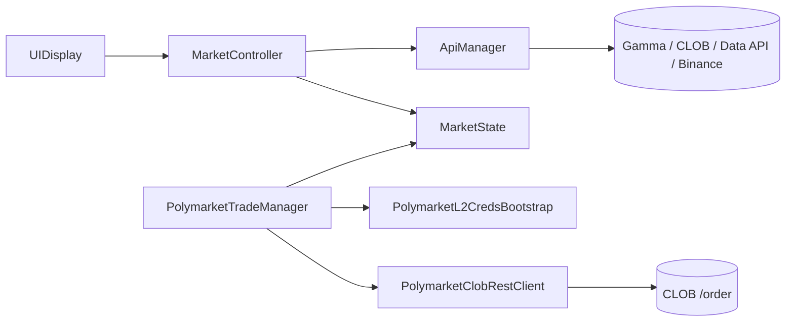

# Polymarket BTC 15m Client

Unity app for Polymarket's 15-minute "Bitcoin Up or Down" markets. It shows live market data and can place real orders.

**Warning:** the trading part sends real orders to Polymarket on Polygon mainnet. Use a separate wallet with a small balance.

## Features

- Finds the current 15-minute BTC market through the Gamma API.
- Takes the BTC price at the start of the interval from Binance (the "price to beat").
- Polls the BTC price and the UP/DOWN order books every second, and recent trades every 5 seconds to calculate volume.
- Switches to the next market when the interval ends.
- Gets Polymarket API credentials with an EIP-712 signature (L1 auth, then L2 API keys).
- Places FOK buy and sell orders, signed locally with Nethereum.

If no market is found, the app falls back to a test market. Without order books it shows random test prices.

## How it works



- `MarketController`: finds the market, runs the polling loops, updates the UI.
- `ApiManager`: HTTP requests to Polymarket and Binance.
- `MarketState`: current market data (interval, prices, order books).
- `PolymarketL2CredsBootstrap`: holds the key and gets API credentials.
- `PolymarketTradeManager`: builds, signs and sends orders.
- `OrderAmountCalculator`: order amount math without Unity dependencies. Covered by tests, not wired into trading yet.

## Requirements

- Unity 6000.3.0f1
- Nethereum for Unity 5.0.0 (installed from OpenUPM via `Packages/manifest.json`)
- .NET SDK 10 to run the tests

## Running

**Monitoring:** open `Assets/Scenes/SampleScene.unity`, press Play and click Start. No key needed.

**Trading:**

1. Enter the private key in the `privateKeyHex` field of `PolymarketL2CredsBootstrap`.
2. Press Play and wait for "Derived existing API credentials." or "Created new API credentials." in the console.
3. Click Start, wait for an active market, then use the Buy UP / Buy DOWN / Sell buttons.

The key is saved in the scene file, so clear the field before committing, otherwise it ends up in git. API credentials are stored in PlayerPrefs (Edit → Clear All PlayerPrefs removes them).

## Tests

```bash
cd OrderMath
dotnet test
```

The order math lives in a separate .NET project so it can be tested without Unity. The tests cover edge cases (zero, negative, NaN, extreme prices, rounding) and compare the class with the original formulas on several million inputs. `Assets/Scripts/OrderAmountCalculator.cs` is a copy of the same file.

## Known issues

- Sell always sells 5 shares, not the actual position size.
- No double-click protection: two clicks on Buy send two orders.
- Money is stored in `float`/`double` instead of `decimal`.
- The key lives in the scene and API secrets in PlayerPrefs.
- `MarketController` is too big and should be split up.
- The fix for trade volume after a market switch hasn't been checked at runtime yet.

## About this project

This was a paid project for a client: an app to watch and trade Polymarket's 15-minute BTC markets. It places real orders on the live API. I wrote the monitoring part myself, using AI to read API docs and speed up routine code. The trading part (EIP-712 signing, API auth, orders) started as AI-generated code that I got working against the live API. Later I did a cleanup pass with AI-assisted review: removed secrets from the logs, fixed a volume bug and moved the order math into a tested class.
