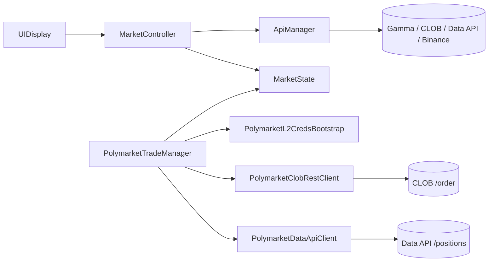

# Polymarket BTC 15m Client

Unity app for Polymarket's 15-minute "Bitcoin Up or Down" markets. It shows live market data and can place real orders.

**Warning:** the trading part sends real orders to Polymarket on Polygon mainnet. Use a separate wallet with a small balance.

## Features

- Finds the current 15-minute BTC market through the Gamma API.
- Takes the BTC price at the start of the interval from Binance (the "price to beat").
- Polls the BTC price and the UP/DOWN order books every second.
- Calculates the 15-minute volume from all trades of the current market: every 5 seconds it loads new trades page by page, keeps them without duplicates and starts over when the market changes.
- Switches to the next market when the interval ends.
- Gets Polymarket API credentials with an EIP-712 signature (L1 auth, then L2 API keys).
- Places FOK buy and sell orders, signed locally with Nethereum. Sell uses the actual position size from the Data API.
- Dry-run mode (default): orders are built and signed but not sent; a short summary goes to the log.

If no market is found, the app falls back to a test market. Without order books it shows random test prices.

## How it works



- `MarketController`: finds the market, runs the polling loops, updates the UI.
- `ApiManager`: HTTP requests to Polymarket and Binance.
- `MarketState`: current market data (interval, prices, order books).
- `PolymarketL2CredsBootstrap`: loads the key from a local file and gets API credentials (kept in memory).
- `PolymarketTradeManager`: builds, signs and sends orders; dry run, double-click guard, amount limit.
- `PolymarketDataApiClient`: reads the current position size for Sell.
- Pure C# classes without Unity dependencies, all covered by tests:
  - `OrderAmountCalculator`: order amounts in `decimal`.
  - `OrderBookCheck`: best price only from a fresh order book of the right token.
  - `OrderSendOutcome`: accepted / rejected / unknown result of `POST /order`.
  - `MarketInterval`, `TradeVolumeCalculator`, `TradeAccumulator`: 15-minute interval and slugs, trade volume, collecting trades between polls.

## Requirements

- Unity 6000.3.0f1
- Nethereum for Unity 5.0.0 (installed from OpenUPM via `Packages/manifest.json`)
- .NET SDK 10 to run the tests

## Running

**Monitoring:** open `Assets/Scenes/SampleScene.unity`, press Play and click Start. No key needed.

**Trading:**

1. Copy `Secrets/polymarket.example.json` to `Secrets/polymarket.local.json` and put the private key there. The `Secrets/` folder is in `.gitignore`, only the example file is tracked.
2. Press Play and wait for "Derived existing API credentials." or "Created new API credentials." in the console.
3. Click Start, wait for an active market, then use the Buy UP / Buy DOWN / Sell buttons.

By default `realTradingEnabled` on `PolymarketTradeManager` is off: Buy and Sell build and sign the order and log a short summary, but do not send it. Turn it on in the Inspector to place real orders. One Buy is limited to 100 USD, and a second click is ignored while an order is in progress.

API credentials are kept in memory only. Older versions stored them in PlayerPrefs; those entries are deleted on start. The key file is read from the project folder, so this setup works in the Editor; a build needs its own place for the file.

## Tests

```bash
cd OrderMath
dotnet test
```

The pure C# classes are linked from `Assets/Scripts` into a separate .NET project, so there is one copy and it can be tested without Unity. The tests cover order amounts (zero, negative, NaN, extreme prices, rounding, rounding down positions), order book checks (wrong token, stale book, empty side), the classification of order results, the 15-minute interval and slugs, trade volume, and collecting trades (duplicates, reset on a new market, when to load the next page). A reference test measures how the `decimal` amounts differ from the old `float` formulas: for example a $16.03 buy is now exactly 16030000 micro-USDC instead of 16030001.

## Problems I solved

**Buying was blocked at the start of a new market.** The log said `Buy ignored: state=Error`, and a few minutes later it worked again. Two causes: any failed order switched the trade manager into an `Error` state that only a new market could clear, and when a new market had no CLOB tokens yet, the tokens of the previous market stayed in use. The "few minutes later" came from a reset timer that restarted the search every 900 s counted from the Start click. Fix: a failed order now logs the reason and leaves trading available; market data is reset on a switch; a market without tokens is searched again every 3 s; the timer is gone. Checked in Play Mode: on a market switch the interval, the conditionId and the collected trades start over.

**The 15-minute volume was far too low.** Each poll summed only the first Data API page, the latest 200 trades, so on a busy market it covered the last few minutes only. Fix: `TradeAccumulator` keeps all trades of the current market between polls without duplicates (a fill is identified by transaction, token, side, wallet, size, price and time), loads more pages until it reaches known trades or the interval start, and resets on a new market. Checked in Play Mode: the first poll loaded 5 pages and 492 trades of the interval.

**Money was calculated in `float`.** I measured the effect first: a $16.03 buy became 16030001 micro-USDC instead of 16030000. Over every cent up to $100 and 999 prices, the old formula was off in 258,741 of 9,990,000 cases, by up to 4 micro-USDC. The order math moved into `OrderAmountCalculator` in `decimal`; a reference test keeps the old formula to show the difference.

**Orders could be priced from the wrong data.** Right after a market switch the "best ask" was still the last price of the previous market, and without order books the app showed random test prices. Fix: `OrderBookCheck` takes the price only from a book whose `asset_id` is the order's token and that is at most 5 s old; otherwise the order is not sent. Checked in Play Mode: a dry-run buy was priced from the live book.

**Two clicks sent two real orders.** Fix: an "order in flight" flag, cleared in a `finally` block (normal end, early exit or exception) and in `OnDisable`. Checked in Play Mode: the second click is ignored with a message.

**A lost answer looked like a failed order.** `POST /order` had no timeout, and every error was treated the same. Fix: a 15 s timeout and `OrderSendOutcome`: no answer or a 5xx means the result is unknown ("check your position before trying again"), a 4xx means rejected ("nothing was bought, try again"). All other requests also got a timeout: a hanging server-time request would have kept an order "in flight" and blocked trading.

**Secrets ended up in logs, the scene and PlayerPrefs.** API credentials and the L1 signature were written to the log, the private key was a serialized field saved into the scene, and API credentials were stored in PlayerPrefs. Fix: the key is read from `Secrets/polymarket.local.json` (git-ignored), credentials stay in memory, and the logs show neither.

**Sell always sold 5 shares.** It now reads the position from the Data API before every attempt and sells the fresh size, rounded down to 0.01; if an earlier attempt already sold it, it stops.

## Known issues

Need checking on the live market:

- Volume lags behind: in Play Mode the Data API kept returning the same newest trade for several minutes while the market was trading. A `Cache-Control: no-cache` request header did not change it, so the next step is to compare the API answer in a browser with and without a cache-busting query parameter.
- Sell by position size: the format of the Data API `/positions` response is taken from the docs, not tested against the live API. The Data API also updates with a delay after a buy, so Sell right after Buy can report "no position".
- Real orders with the `decimal` amounts: the math is tested, but no real order has been placed since the switch from `float`.
- Buying in the first seconds of a new market has not been retried in Play Mode since the fix.

Still open:

- `MarketController` is still large: the pure logic moved out, but market search, polling loops and UI updates are still in one class.
- The 5-share minimum for Sell is hard-coded instead of read from the order book.

## About this project

This was a paid project for a client: an app to watch and trade Polymarket's 15-minute BTC markets. It places real orders on the live API. I wrote the monitoring part myself, using AI to read API docs and speed up routine code. The trading part (EIP-712 signing, API auth, orders) started as AI-generated code that I got working against the live API. Later I did a cleanup pass with AI-assisted review: removed secrets from the logs, fixed a volume bug and moved the order math into a tested class.
