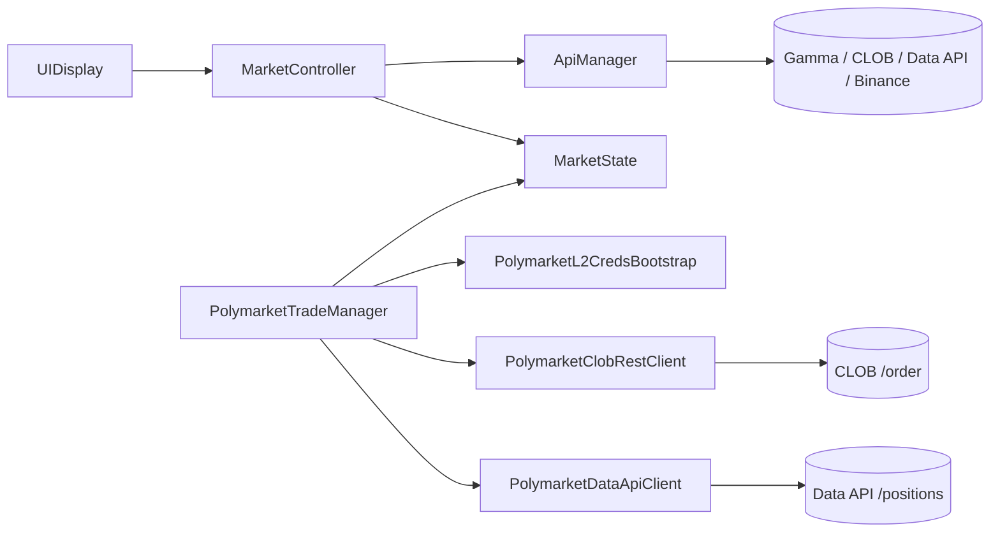

# Polymarket BTC 15m Client

Unity app for Polymarket's 15-minute "Bitcoin Up or Down" markets. It shows live market data and can place real orders.

**Warning:** the trading part sends real orders to Polymarket on Polygon mainnet. Use a separate wallet with a small balance.

## Features

- Finds the current 15-minute BTC market through the Gamma API.
- Takes the BTC price at the start of the interval from Binance (the "price to beat").
- Polls the BTC price and the UP/DOWN order books every second.
- Calculates the 15-minute volume from all trades of the current market: every 5 seconds it loads new trades page by page, keeps them without duplicates and starts over when the market changes.
- Switches to the next market when the interval ends.
- Gets Polymarket API credentials with an EIP-712 signature (L1 auth, then L2 API keys).
- Places FOK buy and sell orders, signed locally with Nethereum. Sell uses the actual position size from the Data API.
- Dry-run mode (default): orders are built and signed but not sent; a short summary goes to the log.

If no market is found, the app falls back to a test market. Without order books it shows random test prices.

## How it works



- `MarketController`: finds the market, runs the polling loops, updates the UI.
- `ApiManager`: HTTP requests to Polymarket and Binance.
- `MarketState`: current market data (interval, prices, order books).
- `PolymarketL2CredsBootstrap`: loads the key from a local file and gets API credentials (kept in memory).
- `PolymarketTradeManager`: builds, signs and sends orders; dry run, double-click guard, amount limit.
- `PolymarketDataApiClient`: reads the current position size for Sell.
- `OrderAmountCalculator`: order amounts in `decimal`, used by `PolymarketTradeManager`.
- `MarketInterval`, `TradeVolumeCalculator`, `TradeAccumulator`: 15-minute interval, market slugs, trade volume and collecting trades between polls, without Unity dependencies.

## Requirements

- Unity 6000.3.0f1
- Nethereum for Unity 5.0.0 (installed from OpenUPM via `Packages/manifest.json`)
- .NET SDK 10 to run the tests

## Running

**Monitoring:** open `Assets/Scenes/SampleScene.unity`, press Play and click Start. No key needed.

**Trading:**

1. Copy `Secrets/polymarket.example.json` to `Secrets/polymarket.local.json` and put the private key there. The `Secrets/` folder is in `.gitignore`, only the example file is tracked.
2. Press Play and wait for "Derived existing API credentials." or "Created new API credentials." in the console.
3. Click Start, wait for an active market, then use the Buy UP / Buy DOWN / Sell buttons.

By default `realTradingEnabled` on `PolymarketTradeManager` is off: Buy and Sell build and sign the order and log a short summary, but do not send it. Turn it on in the Inspector to place real orders. One Buy is limited to 100 USD, and a second click is ignored while an order is in progress.

API credentials are kept in memory only. Older versions stored them in PlayerPrefs; those entries are deleted on start. The key file is read from the project folder, so this setup works in the Editor; a build needs its own place for the file.

## Tests

```bash
cd OrderMath
dotnet test
```

The pure C# classes (`OrderAmountCalculator`, `MarketInterval`, `TradeVolumeCalculator`, `TradeAccumulator`) are linked from `Assets/Scripts` into a separate .NET project, so there is one copy and it can be tested without Unity. The tests cover order amounts (zero, negative, NaN, extreme prices, rounding, rounding down positions), the 15-minute interval and slugs, trade volume, and collecting trades (duplicates, reset on a new market, when to load the next page). A reference test measures how the `decimal` amounts differ from the old `float` formulas: for example a $16.03 buy is now exactly 16030000 micro-USDC instead of 16030001.

## Known issues

Need checking on the live market:

- Sell by position size: the format of the Data API `/positions` response is taken from the docs, not tested against the live API. The Data API also updates with a delay after a buy, so Sell right after Buy can report "no position".
- Real orders with the `decimal` amounts: the math is tested, but no real order has been placed since the switch from `float`.
- Dry-run mode, the double-click guard and the amount limit compile in Unity, but have not been tried in Play Mode.
- Volume: collecting all trades of the market and the reset after a market switch are covered by tests, but have not been compared with the volume on polymarket.com. Paging assumes the Data API returns the newest trades first.

Still open:

- `MarketController` is still large: the pure logic moved out, but market search, polling loops and UI updates are still in one class.
- The 5-share minimum for Sell is hard-coded instead of read from the order book.

## About this project

This was a paid project for a client: an app to watch and trade Polymarket's 15-minute BTC markets. It places real orders on the live API. I wrote the monitoring part myself, using AI to read API docs and speed up routine code. The trading part (EIP-712 signing, API auth, orders) started as AI-generated code that I got working against the live API. Later I did a cleanup pass with AI-assisted review: removed secrets from the logs, fixed a volume bug and moved the order math into a tested class.
